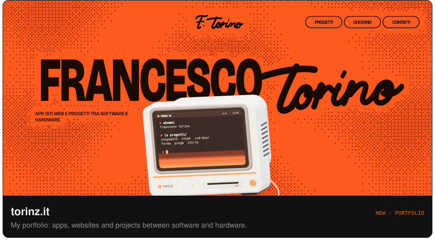

<a href="https://torinz.it">torinz.it</a> &nbsp;·&nbsp; <a href="https://iterix.it">iterix.it</a> &nbsp;·&nbsp; <a href="https://github.com/skfallin?tab=repositories">all repositories</a> &nbsp;·&nbsp; <a href="https://github.com/skfallin/telegram-downloader/releases/latest">latest release</a>

